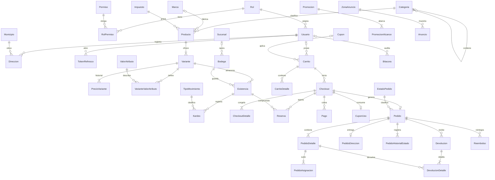
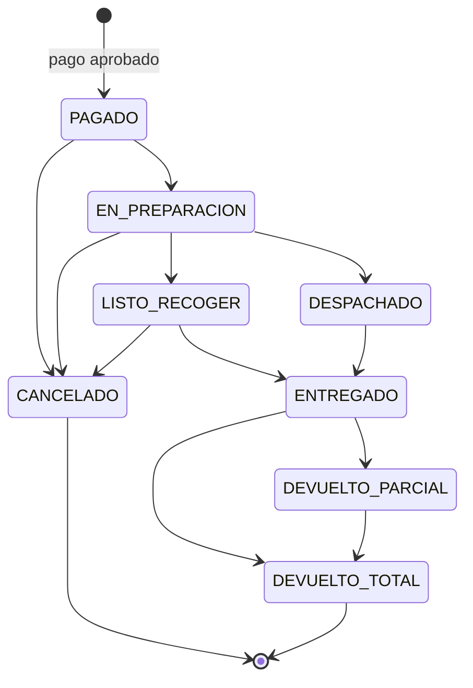

# ShopCart

Plataforma web de ventas para una cadena de tiendas que lanza su tienda en línea. Los clientes compran desde el navegador, y el equipo interno administra catálogo, inventario, promociones y pedidos.

Proyecto del **Tech Challenge 360** de Grupo Pentandra.

| Capa | Tecnología | Carpeta | Estado |
|---|---|---|---|
| Base de datos | Microsoft SQL Server 2019 o superior | [`database/`](database) | Fase 1: aplicada y probada en SQL Server |
| Backend | Node.js 24, TypeScript estricto y Express 5 | [`backend/`](backend) | Fase 1: probado de punta a punta contra SQL Server |
| Frontend | React 18 o superior con TypeScript | `frontend/` | Fase 2, pendiente |

## Contenido

1. [Instalación](#instalación)
2. [Credenciales de prueba](#credenciales-de-prueba)
3. [Diagrama entidad-relación](#diagrama-entidad-relación)
4. [Ciclo de vida del pedido](#ciclo-de-vida-del-pedido)
5. [Arquitectura](#arquitectura)
6. [Cómo se cumple cada requerimiento](#cómo-se-cumple-cada-requerimiento)
7. [Seguridad y autenticación](#seguridad-y-autenticación)
8. [Concurrencia e idempotencia](#concurrencia-e-idempotencia)
9. [Decisiones técnicas](#decisiones-técnicas)
10. [Decisiones abiertas del enunciado](#decisiones-abiertas-del-enunciado)
11. [Documentación de la API](#documentación-de-la-api)
12. [Pruebas](#pruebas)
13. [Limitaciones y mejoras posibles](#limitaciones-y-mejoras-posibles)

## Instalación

### Requisitos

- SQL Server 2019 o superior, con un usuario que pueda crear bases de datos.
- [`sqlcmd`](https://learn.microsoft.com/sql/tools/sqlcmd/go-sqlcmd-utility). En macOS: `brew install sqlcmd`.
- Node.js 24 o superior.
- `openssl`, para generar secretos.

> Los scripts deben ejecutarse con `sqlcmd` o con SQL Server Management Studio en **modo SQLCMD**. Otros clientes, como TablePlus, no procesan los separadores `GO` y aplican solo una parte.

### 1. Base de datos

Genera dos contraseñas, una para el login del API y otra para el de tareas programadas:

```bash
openssl rand -base64 24
```

Define la conexión. La contraseña del administrador se pide sin mostrarla en pantalla:

```bash
printf 'Contraseña del administrador de SQL Server: '; read -rs SQLCMDPASSWORD; export SQLCMDPASSWORD; echo
```

```bash
export DB_SERVIDOR="localhost,1433" DB_USUARIO="sa" API_PASSWORD="primera_contraseña" JOBS_PASSWORD="segunda_contraseña"
```

Aplica los scripts en orden y ejecuta las pruebas de aceptación de la base:

```bash
cd database && ./ejecutar.sh --pruebas
```

El script crea la base `ShopCart`, sus objetos, los logins `shopcart_api` y `shopcart_jobs`, y los datos semilla. Cada script queda registrado en `Config.VersionEsquema`, así que volver a ejecutarlo omite los ya aplicados. Al final debe mostrar `Todas las pruebas pasaron.`

### 2. Backend

```bash
cd backend
cp .env.example .env
npm install
npm run dev
```

Completa `.env` antes de arrancar. El API valida todas las variables al iniciar y no arranca si falta alguna.

| Variable | Valor |
|---|---|
| `DB_SERVER`, `DB_PORT` | Host y puerto del SQL Server |
| `DB_USER`, `DB_PASSWORD` | `shopcart_api` y la primera contraseña |
| `DB_JOBS_USER`, `DB_JOBS_PASSWORD` | `shopcart_jobs` y la segunda contraseña |
| `JWT_SECRET` | Resultado de `openssl rand -base64 48`; mínimo 32 caracteres |
| `DB_TRUST_CERT` | `true` si el servidor usa un certificado autofirmado |
| `CORS_ORIGINS` | Orígenes del frontend, separados por coma |

El API queda en `http://localhost:3000`. Para comprobarlo, `GET /health` responde `{"success":true,...}`.

Para producción: `npm run build && npm start`.

## Credenciales de prueba

Existen solo en los datos semilla. La contraseña de todos es `ShopCart#2026`.

| Usuario | Rol | Puede |
|---|---|---|
| `admin@shopcart.test` | Administrador | Todo: catálogo, precios, cupones, usuarios, reportes, bitácora y configuración |
| `operador@shopcart.test` | Operador | Gestionar pedidos e inventario |
| `cliente1@shopcart.test` | Cliente | Comprar y consultar solo su información |
| `cliente2@shopcart.test` | Cliente | Igual que el anterior, para probar aislamiento |
| `cliente3@shopcart.test` | Cliente | Igual que el anterior |

**Pagos simulados.** Cualquier `tokenPago` se aprueba, y `tok_rechazada` se rechaza.

**Cupones de la semilla:**

| Código | Regla |
|---|---|
| `BIENVENIDA10` | 10 % sobre compras desde Q100, un uso por cliente |
| `AUDIO50` | Q50 en la categoría Audio, desde Q300 |
| `VENCIDO` | Vencido, para probar el rechazo |

## Diagrama entidad-relación

Vista de las entidades principales. El modelo completo, con sus 61 tablas y 93 llaves foráneas, se encuentra en [`database/docs/er`](database/docs/er). Esa carpeta tiene tres archivos:

- `ShopCart.dbml`: se pega en [dbdiagram.io](https://dbdiagram.io).
- `ShopCart.mmd`: el mismo modelo en Mermaid.
- `generar_er.py`: regenera ambos desde los scripts.



La tabla `Existencia` es el saldo del kardex, y una vista comprueba que siempre coincidan. Las demás desnormalizaciones también son intencionales, como los montos congelados del pedido. Todas están justificadas en la [sección 3 de Diseno_BD.md](database/docs/Diseno_BD.md#3-normalización).

## Ciclo de vida del pedido



| Regla | Cómo se cumple |
|---|---|
| Solo se crea el pedido con el pago aprobado | No existe un estado "pendiente de pago": el pedido nace `PAGADO` |
| Transiciones permitidas | Viven en la tabla `TransicionEstadoPedido`. Un trigger rechaza cualquier otra, incluso un `UPDATE` directo |
| Cancelación | Permitida solo antes del despacho. Reintegra existencia por kardex, devuelve el uso del cupón y crea un reembolso pendiente |
| Devoluciones | Totales o parciales por línea, con un `CHECK` que impide devolver más de lo vendido |
| Historial | Cada cambio registra usuario, fecha, estado anterior, estado nuevo y motivo |
| Quién avanza el estado | El Operador. El Cliente consulta su historial y puede cancelar mientras se permita |

## Arquitectura

```
shopcart/
├── database/
│   ├── scripts/        001 a 016, numerados y versionados
│   ├── docs/           Diseño, normalización y diagrama ER
│   └── ejecutar.sh     Aplica los scripts en orden
├── backend/
│   ├── src/
│   │   ├── core/       Configuración, acceso a SP, HTTP, seguridad y tareas
│   │   ├── modules/    Un módulo por dominio
│   │   ├── composition.ts
│   │   └── main.ts
│   ├── tests/          Unitarias, de contrato y de punta a punta
│   └── docs/api/       OpenAPI y colección de Bruno
└── frontend/           Fase 2
```

### Monolito modular con arquitectura hexagonal

Hay 12 módulos: `auth`, `usuarios`, `clientes`, `catalogo`, `inventario`, `carrito`, `cupones`, `checkout`, `pedidos`, `reportes`, `marketing` y `configuracion`. Cada uno tiene cuatro capas:

| Capa | Responsabilidad |
|---|---|
| `domain` | Esquemas de entrada, tipos y puertos (interfaces). No conoce Express ni SQL Server |
| `application` | Casos de uso. Dependen solo de los puertos |
| `infrastructure` | Adaptadores concretos: stored procedures, bcrypt, JWT y pasarela |
| `http` | Rutas: validan y delegan, sin lógica de negocio |

`src/composition.ts` es la raíz de composición: el único archivo que conoce las implementaciones concretas.

**SOLID en el código:**
- **Responsabilidad única:** cada capa cambia por un solo motivo.
- **Abierto/cerrado:** una pasarela real se agrega implementando `PasarelaPago`, sin tocar el checkout.
- **Sustitución de Liskov:** `SqlFalso` reemplaza a `MssqlGateway` en las pruebas.
- **Segregación de interfaces:** cada módulo declara su propio puerto.
- **Inversión de dependencias:** los servicios reciben interfaces por constructor.

**Una ruta, una definición.** `ruta({...})` produce el endpoint, su validación, su control de acceso y su documentación OpenAPI, así la documentación no se desalinea del código.

### Base de datos

| Objeto | Cantidad | Detalle |
|---|---|---|
| Tablas | 61 | En 3FN, con PK, FK, `UNIQUE`, `NOT NULL` y `CHECK` |
| Stored procedures | 101 | 87 públicos en `Api`, 10 internos en `Interno` y 4 en `Job` |
| Triggers | 17 | Bitácora, inmutabilidad, máquina de estados y registro de cambios de esquema |
| Funciones tipo tabla | 7 | Precio vigente, descuento de cupón y disponibilidad, entre otras |
| Vistas | 7 | Reportes, conciliación de kardex y carritos abandonados |
| Errores de negocio | 38 | Catálogo con código, mensaje y estado HTTP |

**Esquemas por dominio:** `Seguridad`, `Clientes`, `Catalogo`, `Inventario`, `Ventas`, `Marketing`, `Auditoria` y `Config`. Los programables viven en `Api`, `Interno` y `Job`.

**Nomenclatura:** sigue el estándar del enunciado: `SP_Modulo_Proceso`, `VW_Modulo_Proceso`, `FU_Modulo_Proceso` e `IDTabla`. Se extiende con `TR_`, `PK_`, `FK_`, `UQ_`, `CK_`, `DF_`, `IX_` y `UX_`.

**Montos:** todos usan `DECIMAL(18,2)`, y el costo usa `DECIMAL(18,4)`; nunca `FLOAT` ni `REAL`. Las fechas se guardan en UTC, y los reportes usan la hora de Guatemala.

## Cómo se cumple cada requerimiento

| Requerimiento | Implementación |
|---|---|
| **RF-01** Autenticación y acceso | Tres roles con permisos en tablas. JWT de corta duración y refresh token con rotación. El usuario siempre sale del token. Los usuarios se desactivan sin borrarse |
| **RF-02** Catálogo | Categorías jerárquicas, productos con variantes y SKU único. El precio tiene historial con vigencias. Búsqueda con filtros, orden y paginación. Un producto se da de baja de forma lógica |
| **RF-03** Inventario | Kardex que solo admite inserciones. Disponible = física − reservada. Un ajuste exige motivo y no deja saldos negativos |
| **RF-04** Carrito | Carrito de cliente y de invitado, que se fusionan al iniciar sesión. No permite agregar más que lo disponible. Los totales usan decimales exactos |
| **RF-05** Cupones | Porcentaje o monto fijo, con vigencia, mínimo, límite total, límite por cliente y categoría. Un error distinto por causa. Un solo cupón por pedido |
| **RF-06** Checkout y pago | Reserva de 15 minutos. Pedido, detalle, kardex y cupón en una sola transacción. Idempotente en tres capas |
| **RF-07** Pedidos | Máquina de estados en datos y validada por trigger. Cancelaciones y devoluciones reintegran existencia por kardex. Una tarea libera cada minuto las reservas vencidas |
| **RF-08** Reportes | Ventas por día, semana y mes; ventas por categoría; los 10 más vendidos; ticket promedio. Solo cuentan pedidos completados, y restan devoluciones |
| **RF-09** Bitácora | Triggers registran usuario, fecha, entidad, acción, valor anterior y valor nuevo. No se puede modificar, borrar ni truncar |

## Seguridad y autenticación

| Tema | Decisión |
|---|---|
| Contraseñas | bcrypt con costo 12. Política de al menos 10 caracteres, con letras y números |
| Access token | JWT HS256 de 15 minutos. Al verificar se fijan algoritmo, emisor y audiencia |
| Refresh token | Opaco, de 256 bits. En BD solo se guarda su SHA-256. Viaja en cookie `HttpOnly`, `Secure` y `SameSite=Strict` |
| Rotación | Cada uso emite uno nuevo. Reutilizar uno ya rotado revoca toda su familia |
| Fuerza bruta | Bloqueo de la cuenta tras 5 intentos, y límite de 10 intentos por minuto por IP |
| Enumeración de usuarios | Mismo mensaje y mismo costo de CPU si el correo no existe |
| Clientes y personal | Misma tabla, con rol y permisos. Los permisos se leen de la BD, no del token |
| Autorización | Doble: en la ruta y otra vez dentro de cada SP |
| Aislamiento entre clientes | El usuario sale del JWT, nunca del body ni de la URL. El carrito se deduce de la sesión. Un recurso ajeno responde 404 |
| CSRF | Cookies `SameSite` y rechazo de escrituras desde orígenes no permitidos |
| SQL injection | No hay SQL en el código, y una prueba lo verifica. El login del API solo puede ejecutar el esquema `Api` |
| Cabeceras | `helmet`, CORS con lista de orígenes, límite de 100 KB por petición y `x-powered-by` desactivado |
| Errores | El cliente nunca recibe detalles internos; solo un `requestId` para rastrearlo en el log |
| Logs | Ocultan `Authorization` y las cookies |
| Pagos | Solo se recibe un token de pasarela, nunca datos de tarjeta |
| Secretos | Ninguno en el repositorio. `.env.example` documenta las variables |

**Mínimo privilegio, comprobado en el servidor:** el login `shopcart_api` no puede leer tablas, modificarlas ni ejecutar procedimientos internos. SQL Server lo rechaza con el error 229.

**Respuestas HTTP:** un token ausente, inválido o expirado responde 401. Un recurso no permitido responde 403.

## Concurrencia e idempotencia

| Problema | Solución |
|---|---|
| Dos clientes compran la última unidad | La reserva es un `UPDATE` con la disponibilidad en el `WHERE`, atómico por fila. Si todo lo demás fallara, un `CHECK` impide que lo reservado supere la existencia física |
| Doble clic o reintento de red | `Idempotency-Key` obligatoria en el checkout y el pago. La llave de cobro es el checkout, no la petición: dos clics producen un solo cobro y un solo pedido |
| Un pago que llega tarde | Si la reserva ya expiró, el cobro se registra para reembolso y se responde 410 |
| Límite de usos de un cupón | El contador se incrementa con la condición en el `WHERE`, y un `CHECK` lo respalda |
| Deadlocks | Todos los SP bloquean en el mismo orden. El backend reintenta hasta tres veces, porque el motor ya hizo rollback |
| Lecturas que bloquean | `READ_COMMITTED_SNAPSHOT`: catálogo y reportes no bloquean el checkout |
| Pedido a medias | `XACT_ABORT ON` y una sola transacción por operación |

Respaldo de la idempotencia en la base: `SolicitudIdempotente`, `UQ_Pedido_Checkout` y un índice único que impide dos pagos aprobados para el mismo checkout.

## Decisiones técnicas

### Librerías

| Librería | Por qué |
|---|---|
| `express` 5 | Exigido por el enunciado. La versión 5 propaga los errores de funciones `async` al manejador central |
| `mssql` | Driver oficial de la comunidad para SQL Server, con parámetros tipados |
| `zod` | Validación y tipos de TypeScript desde una sola fuente. También genera la documentación OpenAPI |
| `bcrypt` | Hash de contraseñas probado y con costo ajustable |
| `jsonwebtoken` | Firma y verificación de JWT |
| `helmet`, `cors` | Cabeceras de seguridad y control de orígenes |
| `express-rate-limit` | Límite de peticiones, más estricto en autenticación |
| `cookie-parser` | Lectura de las cookies de sesión y de invitado |
| `pino`, `pino-http` | Logs estructurados en JSON, rápidos y con datos sensibles ocultos |
| `swagger-ui-express` | Documentación interactiva de la API |
| `dotenv` | Configuración por variables de entorno |
| `vitest`, `supertest` | Pruebas unitarias y HTTP sin levantar un servidor |
| `tsx`, `typescript`, `eslint` | Desarrollo, tipado estricto y estándar de código |

### Otras decisiones

- **Sin ORM:** lo exige el enunciado. `SqlGateway` es un puerto que solo permite invocar procedimientos con parámetros tipados; no hay forma de enviar SQL como texto.
- **Tareas programadas en el backend:** liberan reservas vencidas y publican eventos cada minuto. Funcionan también en SQL Server Express, que no trae SQL Agent.
- **Patrón outbox:** los eventos de pedido se guardan en la misma transacción que el pedido y se publican después, así nunca se avisa de un pedido que hizo rollback.
- **Caché de permisos de 30 segundos:** evita una consulta por petición, y desactivar a un usuario la invalida al instante en la instancia.
- **Convención de respuestas:** las correctas son `{ success, data, meta? }` y los errores `{ success: false, error: { codigo, mensaje, detalles?, requestId } }`. Los campos conservan el nombre de las columnas, como `IDPedido`, y los `BIGINT` llegan como texto para no perder precisión.

### Extras más allá del enunciado

Se agregaron sucursales con varias bodegas, recoger en tienda, traslados entre bodegas, tasas de impuesto con vigencia, datos para factura electrónica, costo promedio con reporte de margen, promociones automáticas, anuncios por zona con métricas, tarifas de envío por departamento y parámetros configurables.

La justificación de cada uno está en la [sección 2 de Diseno_BD.md](database/docs/Diseno_BD.md#2-extras-que-agregamos-y-por-qué).

De los extras opcionales del enunciado, está implementado el **rate limiting en autenticación**.

## Decisiones abiertas del enunciado

| Tema | Postura |
|---|---|
| Compra como invitado | El invitado arma su carrito, pero inicia sesión para pagar. Al hacerlo, su carrito se une al de su cuenta |
| Pedido "completado" para reportes | `ENTREGADO` o `DEVUELTO_PARCIAL`. Se excluyen cancelados y devoluciones totales, y se restan las devoluciones parciales |
| Ticket promedio | Monto neto vendido entre pedidos completados del periodo |
| Cupón y promoción a la vez | Se acumulan: el cupón se calcula sobre el precio ya rebajado. Entre varias promociones aplica la mejor para el cliente |
| Uso del cupón | Se reserva al iniciar el pago y se confirma con el pedido. Si el checkout expira o el pedido se cancela, el uso se devuelve |
| Precio respetado | Se congela al iniciar el pago, que es cuando el cliente confirma |
| IVA | Los precios incluyen el 12 %. Cada línea guarda base e IVA. El envío también se trata con IVA incluido |
| Redondeo del descuento | Se prorratea entre líneas, y el residuo va a la línea mayor para que todo cuadre al centavo |
| Envío | Tarifa por departamento, gratis desde un monto. Recoger en tienda no cobra envío |
| Recoger en tienda | Todo el pedido debe estar disponible en la sucursal elegida |
| Varias bodegas | La reserva toma existencia por prioridad de bodega, y una línea puede surtirse de varias |
| Devoluciones | Las registra el Operador. No reembolsan el envío, y el monto incluye el prorrateo del cupón |
| Reembolsos | Quedan `PENDIENTE` y se marcan como procesados. Ejecutarlos en la pasarela es externo al sistema |
| Baja de productos | Siempre lógica, porque el historial de precios y la bitácora son inmutables |
| Zona horaria | Se guarda en UTC. Los reportes usan UTC-6, ya que Guatemala no aplica horario de verano |
| Carrito abandonado | Sin actividad por 1440 minutos, configurable en `Config.Parametro` |

## Documentación de la API

Con el API arrancado:

- **Swagger UI:** `http://localhost:3000/api/docs`
- **OpenAPI en JSON:** `http://localhost:3000/api/openapi.json`

### Probar con Bruno

En [`backend/docs/api`](backend/docs/api) hay un `openapi.yml` y una colección nativa de Bruno con 91 peticiones. Ambos se regeneran desde las rutas con `npm run docs:api`.

1. En Bruno, usa **Open Collection** y elige la carpeta `backend/docs/api/bruno`.
2. Selecciona el entorno **Local**.
3. Ejecuta una petición de inicio de sesión: el token se guarda solo.

La colección genera la `Idempotency-Key` en cada envío y guarda el `idCheckout` para el pago.

## Pruebas

| Tipo | Comando | Qué cubre | Resultado |
|---|---|---|---|
| Unitarias, de contrato y HTTP | `cd backend && npm test` | Autenticación, idempotencia, aislamiento, errores y seguridad HTTP, sin base de datos | 127 de 127 |
| De punta a punta | `cd backend && npm run test:e2e` | Flujo real contra el API y SQL Server, incluidas la concurrencia y el doble clic | 51 de 51 |
| De la base de datos | `cd database && ./ejecutar.sh --pruebas` | RF-01 a RF-09 directamente en SQL Server, incluidas inmutabilidad y transiciones | 33 de 33 |

La prueba de contrato compara cada llamada del backend con la firma real del procedimiento en los scripts SQL, y falla si un parámetro no existe o falta uno obligatorio.

Verificación estática: `npm run typecheck && npm run lint && npm run build`.

## Limitaciones y mejoras posibles

- **Pasarela de pago simulada.** Guarda sus cobros en memoria. Una real debe implementar `PasarelaPago` y usar la misma llave de idempotencia.
- **Concurrencia.** Se probó con 3 clientes simultáneos por caso. Demuestra el mecanismo, no el rendimiento bajo carga.
- **Una sola instancia.** El límite de peticiones y la caché de permisos viven en memoria. Con varias instancias deben moverse a Redis.
- **Búsqueda.** Usa `LIKE`, suficiente para la semilla. Con un catálogo grande conviene Full-Text Search y una caché.
- **Bitácora.** Los SP no reciben la IP del cliente, así que `DireccionIP` queda vacía.
- **Sesiones.** La rotación del refresh token no tiene margen de gracia: dos pestañas renovando a la vez pueden cerrar la sesión.
- **Administradores del servidor.** Un `sysadmin` puede saltarse triggers y permisos. Para protección total se requiere SQL Server Audit.
- **Extras opcionales pendientes:** dashboard en tiempo real, exportación a Excel o PDF, y caché de reportes.

El diseño completo de la base, con normalización y extras, está en [database/docs/Diseno_BD.md](database/docs/Diseno_BD.md).
