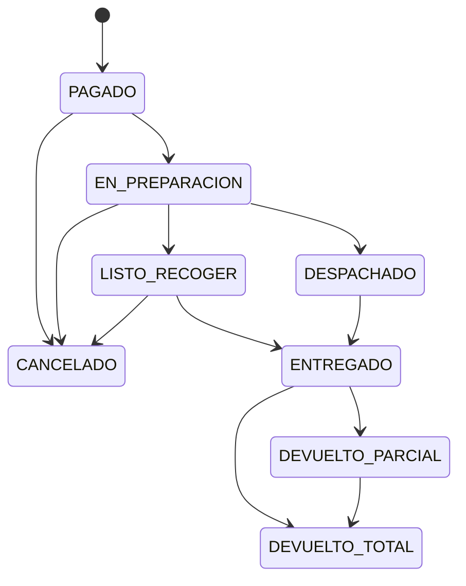

# ShopCart: diseño de la base de datos

Motor: SQL Server 2019 o superior. No se usa ninguna función exclusiva de 2022.

**Estado:** los scripts aún no se han ejecutado en un SQL Server. Hasta correr `./ejecutar.sh --pruebas`, ningún comportamiento descrito aquí está comprobado.

## 1. Lo que pide el enunciado

| Requisito | Dónde se resuelve |
|---|---|
| RF-01 Roles, JWT, refresh con rotación | `Seguridad.*`, `SP_Seguridad_*`. Solo se guarda el SHA-256 del refresh token; reutilizar uno rotado revoca toda su familia |
| RF-01 Aislamiento entre clientes | Los SP filtran por el usuario de la sesión. El carrito se deduce de la sesión, nunca se recibe un `IDCarrito`. Lo ajeno responde 404 |
| RF-02 Catálogo y variantes | `Catalogo.*`. Precio con vigencias en `PrecioVariante`. Baja siempre lógica |
| RF-03 Inventario y kardex | `Inventario.Kardex` solo admite inserciones. `Existencia` es su saldo. `VW_Inventario_ConciliacionKardex` debe dar cero filas |
| RF-04 Carrito | `Ventas.Carrito*`, incluido el carrito de invitado por token |
| RF-05 Cupones | `Marketing.Cupon`, `Ventas.CuponUso`. Un error distinto por causa |
| RF-06 Checkout | `SP_Checkout_IniciarPago` y `SP_Pedidos_CrearPedido` |
| RF-07 Pedidos y devoluciones | Estados y transiciones en tablas, validados por trigger |
| RF-08 Reportes | `VW_Dashboard_*`, `SP_Dashboard_*` |
| RF-09 Bitácora | `Auditoria.Bitacora`, llenada por triggers e inmutable |
| Solo stored procedures | El login de la aplicación solo tiene `EXECUTE` sobre el esquema `Api` |
| Nomenclatura | `SP_`, `VW_`, `FU_`, llaves `IDTabla`. Además `TR_`, `PK_`, `FK_`, `UQ_`, `CK_`, `DF_`, `IX_`, `UX_` |

### Cómo se evita cada riesgo del negocio

- **Sobreventa.** La reserva es un `UPDATE ... WHERE Fisica - Reservada >= @Tomar`, atómico por fila. Si todo lo demás fallara, `CK_Existencia_Reservada` lo impide en el motor.
- **Doble cobro o pedido.** Hay tres capas: `SolicitudIdempotente`, `UQ_Pedido_Checkout` y `UX_Pago_AprobadoPorCheckout`.
- **Precio respetado.** `IniciarPago` congela los precios en `CheckoutDetalle` y el pedido los copia.
- **Límite de cupón.** `UsosActuales` se incrementa con la condición en el `WHERE`, y `CK_Cupon_Usos` es la última barrera. Ese bloqueo también serializa el conteo por cliente.
- **Pedido a medias.** Una sola transacción con `XACT_ABORT ON`.
- **Deadlocks.** Todos los SP bloquean en el mismo orden: carrito, cupón, existencias por `IDVariante`. El backend debe reintentar el error 1205.

### Flujo de pago

1. `SP_Checkout_IniciarPago`: congela precios, valida el cupón y reserva 15 minutos.
2. El backend cobra en la pasarela usando `IDCheckout` como referencia.
3. `SP_Pedidos_CrearPedido`: crea todo junto. Si el cobro llega con la reserva vencida, se guarda como `REEMBOLSO_PENDIENTE` y se responde 410.

Si la pasarela rechaza, se llama `SP_Pagos_RegistrarRechazo` y el cliente puede reintentar hasta que expire.

### Ciclo de vida del pedido



## 2. Extras que agregamos y por qué

| Extra | Por qué vale la pena | Costo de no tenerlo |
|---|---|---|
| **Sucursales y múltiples bodegas** | El enunciado habla de una cadena de tiendas. Una línea puede surtirse de varias bodegas por prioridad | Migrar existencia y kardex después es la peor refactorización posible |
| **Recoger en tienda** | Convierte sucursales en punto de entrega, sin costo de envío. Igual que en Intelaf, todo debe estar en la misma sucursal | Se pierde la ventaja frente a una tienda solo en línea |
| **Traslados entre bodegas** | Dos movimientos de kardex enlazados | Se harían con ajustes manuales, sin trazabilidad |
| **Tasas de impuesto con vigencia** | Cambiar el IVA es un dato, no un despliegue. Cada línea guarda su base y su IVA | Pedidos viejos se recalcularían mal |
| **Datos fiscales y `Factura`** | Guatemala exige factura electrónica FEL. Queda lista para un certificador | Habría que tocar el flujo de compra |
| **Costo promedio y margen** | `SP_Dashboard_MargenPorProducto` muestra ganancia real, no solo ventas | Se vende mucho sin saber si se gana |
| **Promociones automáticas** | Descuento sin código por categoría, marca, producto o variante, con vigencia | Marketing dependería de cambiar precios a mano |
| **Anuncios por zona** | Marketing publica banners con fechas sin ayuda técnica. Es el carrusel de Intelaf | Cada campaña requeriría un despliegue |
| **Métricas de anuncios** | Impresiones y clics agregados por día, sin una fila por evento | No se sabe qué campaña funciona |
| **Marcas y fichas técnicas** | Filtros básicos en tecnología | Búsqueda pobre |
| **Tarifas de envío por departamento** | Costo real por zona y envío gratis desde un monto | Costo fijo que pierde dinero fuera de la capital |
| **Parámetros configurables** | Minutos de reserva, abandono y bloqueo sin desplegar | Valores fijos en código |
| **Bloqueo por intentos** | Frena ataques de contraseña | Cuentas expuestas |
| **Outbox `EventoSalida`** | Correos y tiempo real se publican después del commit | Avisos de pedidos que hicieron rollback |
| **Catálogo de errores** | Una sola fuente para código, mensaje y HTTP | Mapeos duplicados en el backend |
| **Registro de cambios de esquema** | Quién alteró qué, incluso si desactivó un trigger | Una auditoría que se puede apagar sin dejar rastro |

Quedan fuera por ahora, porque se agregan sin tocar lo existente: precios de mayoreo, cuotas bancarias, favoritos, reseñas, boletín y órdenes de compra a proveedores.

## 3. Normalización

Todas las tablas cumplen 3FN, con estas desnormalizaciones deliberadas:

| Dato | Por qué se conserva |
|---|---|
| `Existencia.Fisica` y `Reservada` | Saldo del kardex. Sumar el kardex en cada venta no escala y no permite un bloqueo por fila. Se comprueba con la vista de conciliación |
| Montos en `Pedido`, `PedidoDetalle` y `Checkout` | Instantánea legal. Debe sobrevivir a cambios de precio, tasa o nombre. Cuadran por `CHECK` |
| `PedidoDetalle.SKU` y `NombreProducto` | Igual: lo que el cliente compró, aunque luego cambie |
| `PedidoDireccion` | Copia de la dirección al comprar |
| `Cupon.UsosActuales` | Contador para controlar concurrencia. Se puede reconstruir desde `CuponUso` |
| `PedidoDetalle.CantidadDevuelta` | Su `CHECK` impide devolver de más bajo concurrencia |
| `Kardex.SaldoAnterior` y `SaldoNuevo` | Lectura histórica directa, validada por `CHECK` |

## 4. Decisiones que el enunciado deja abiertas

- **Checkout con cuenta.** El invitado arma su carrito, pero inicia sesión para pagar. `SP_Carrito_FusionarInvitado` une ambos carritos.
- **"Pedido completado"** significa `ENTREGADO` o `DEVUELTO_PARCIAL`. Los reportes restan lo devuelto.
- **Ticket promedio** usa pedidos completados y se calcula sobre el monto neto.
- **Cupón sobre promoción.** Se acumulan: el cupón se calcula sobre el precio ya rebajado. De varias promociones aplica la mejor para el cliente.
- **Cupón en carrito.** Al iniciar el pago se reserva un uso; si el checkout expira, se devuelve. Cancelar el pedido también lo devuelve.
- **Devoluciones.** Las registra el Operador. No reembolsan el envío. El monto incluye el prorrateo del cupón.
- **Reembolso.** Queda en `PENDIENTE`. Ejecutarlo en la pasarela es externo a la BD.
- **Baja de productos.** Siempre lógica, porque el historial de precios y la bitácora son inmutables.
- **Horas.** Se guardan en UTC. Los reportes usan `FechaLocal`, UTC-6 fijo, porque Guatemala no aplica horario de verano.
- **IVA del envío.** Se trata como incluido, igual que los precios.

## 5. Para el backend

- El login `shopcart_api` solo ejecuta `Api.*`. Las tareas usan `shopcart_jobs` y el esquema `Job`.
- Llamar `Job.SP_Inventario_LiberarReservasVencidas` cada minuto desde SQL Agent o, en Express, desde un cron. Hasta que corra, una reserva vencida sigue ocupando existencia.
- Errores de negocio: números 51000 a 59999. `SP_Config_ListarErrores` da el mapeo a HTTP.
- `@HashSolicitud` es el SHA-256 del cuerpo de la petición. `@Llave` llega en la cabecera `Idempotency-Key`.
- Los SP de carrito reciben `@IDUsuario` o `@HashTokenInvitado`, y `@IDUsuario` siempre sale del JWT, nunca del body.

## 6. Límites conocidos

- La búsqueda usa `LIKE`, suficiente para la semilla. Con catálogos grandes conviene Full-Text Search.
- `SP_Catalogo_BuscarProductos` calcula precio y existencia por producto; con mucho tráfico debe ir detrás de una caché.
- Un `sysadmin` puede saltarse triggers y permisos. La protección total requiere SQL Server Audit y separar esa cuenta.
- La rotación de refresh tokens no tiene margen de gracia: dos pestañas refrescando a la vez cierran la sesión.
- La semilla reparte las fechas de pedidos desactivando un trigger una sola vez. Es la única excepción.

## 7. Instalación

```bash
export DB_SERVIDOR="host,1433"
export DB_USUARIO="sa"
export SQLCMDPASSWORD="..."
export API_PASSWORD="..."
export JOBS_PASSWORD="..."
./ejecutar.sh --pruebas
```

Si instalas a mano, ejecuta del `001` al `014` y luego el `016`, que agrega procedimientos para el backend; `015_Pruebas.sql` va al final. Requiere `sqlcmd`. Usuarios de prueba: `admin@`, `operador@`, `cliente1@`, `cliente2@` y `cliente3@shopcart.test`, todos con contraseña `ShopCart#2026`.
